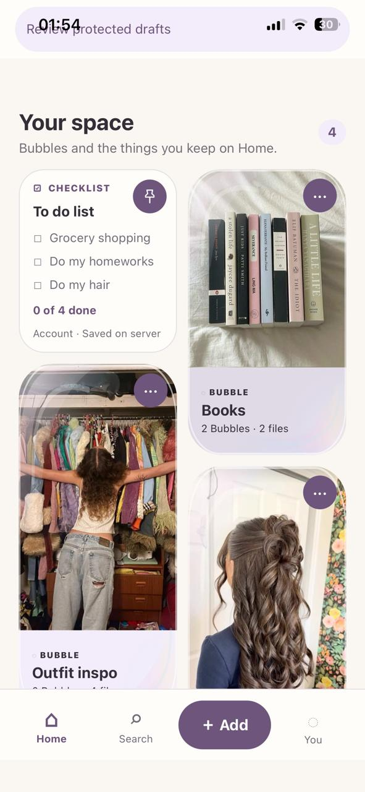
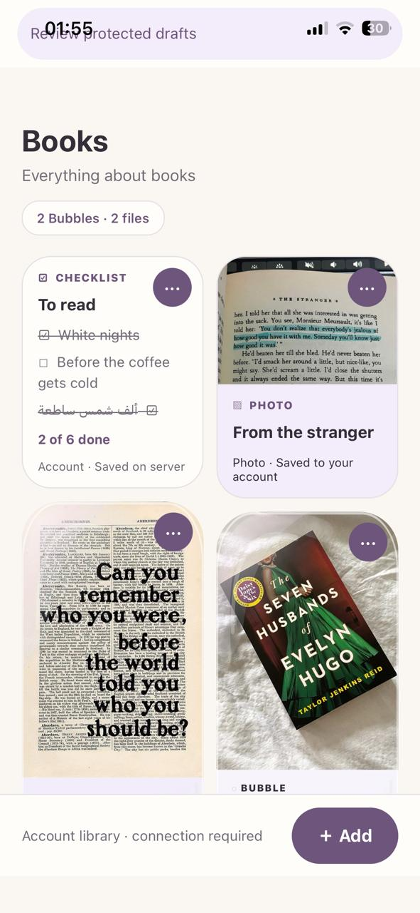
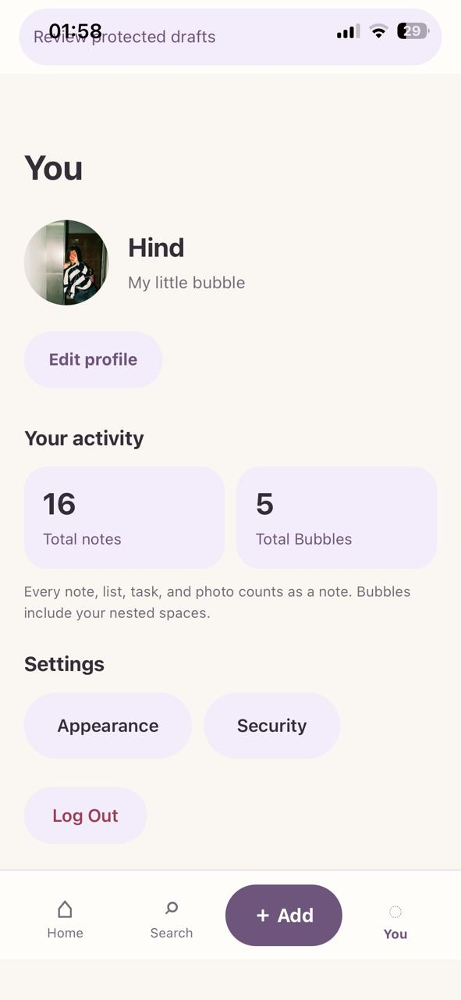

# Bubble

[](https://github.com/hindkhial/bubble/actions/workflows/ci.yml)

A personal iPhone app for notes, checklists, photos and collections called
**Bubbles**. A calm cream-and-lavender interface keeps everyday thoughts and
lists together, with customizable colors and light or dark appearance.

## A look inside

Follow the walkthrough below, captured on iPhone 13. Tap any screenshot to view it at full size.

<p align="center"><strong>1. Welcome / login · 2. Home · 3. Inside a Bubble</strong></p>

<p align="center">
  <a href="docs/screenshots/welcome.jpg"></a>
  <a href="docs/screenshots/home.jpg"></a>
  <a href="docs/screenshots/collection.jpg"></a>
</p>

<p align="center"><strong>4. Bubble contents · 5. Add something · 6. Add note</strong></p>

<p align="center">
  <a href="docs/screenshots/collection-contents.jpg"></a>
  <a href="docs/screenshots/add.jpg"></a>
  <a href="docs/screenshots/new-note.jpg"></a>
</p>

<p align="center"><strong>7. Add checklist · 8. Profile · 9. Appearance</strong></p>

<p align="center">
  <a href="docs/screenshots/new-checklist.jpg"></a>
  <a href="docs/screenshots/you.jpg"></a>
  <a href="docs/screenshots/appearance-light.jpg"></a>
</p>

## What Bubble does

- Organize notes, checklists and photos inside Bubbles, or keep them on Home.
- Find content through Search and keep important items pinned.
- Personalize your profile, avatar, photo and app appearance.
- Read previously downloaded notes and checklists offline after Face ID or
  device-passcode unlock.
- Protect unsaved note/checklist drafts and review them before explicitly
  publishing a new copy.

Bubble is currently maintained for personal iPhone installation through Xcode.
App Store, TestFlight, public web hosting and Android distribution are deferred.
Browser tooling remains available for development and regression testing.

## Accounts and offline access

First-time login and registration require the trusted HTTPS backend. Account
content is stored by the Spring Boot/PostgreSQL backend; existing device content
is never uploaded automatically.

After successful online verification, account-specific encrypted snapshots allow
**read-only notes/checklist access and local search for up to seven days**.
Face ID or device passcode is required at launch and after backgrounding.
Offline unlocks do not extend that allowance. Reboot, expiry, suspicious clock
changes, logout or a known authentication rejection require online verification.

Offline mode does not create or edit server content, synchronize automatically,
or cache Bubble/photo images. Draft recovery requires explicit review and
confirmation to publish a new copy. Device-only encryption keys cannot be
recovered from a downloaded app container alone.

See [offline protection](docs/OFFLINE-ACCOUNT-PROTECTION.md) and the
[physical iPhone verification record](docs/IOS-OFFLINE-VERIFICATION.md) for
the tested behavior, security trade-offs and remaining checks.

## Technology

| Area | Stack |
| --- | --- |
| iPhone interface | Expo SDK 57, React Native 0.86.3, TypeScript, Expo Router |
| Native storage and protection | SQLite for legacy device content; Swift, CryptoKit and device-only Keychain for account snapshots/drafts; private app files for photos |
| Backend | Java 21, Spring Boot, Spring Security, Spring Data JPA, PostgreSQL, Flyway |
| Development and checks | pnpm, Maven, Docker, GitHub Actions, Playwright |

## Development

The complete application is on **`integration`**, the default branch. The
original `frontend` and `backend` branches are preserved as development history.

For JavaScript checks, use Node.js 22.6+ and pnpm 10.18.3:

```sh
git clone https://github.com/hindkhial/bubble.git
cd bubble
pnpm install --frozen-lockfile
pnpm typecheck
pnpm test
```

For native builds, follow the [iPhone setup and installation guide](docs/PERSONAL-IPHONE.md)
and [native development notes](docs/IOS-NATIVE.md). Xcode, the compatible iOS SDK,
CocoaPods and your existing signing configuration are required. A JavaScript
export or browser preview does not establish native compilation.

The backend needs Java 21, Maven and PostgreSQL. Its integration tests use
disposable PostgreSQL containers. See [backend setup](backend/README.md) and
[private staging](docs/STAGING.md). Keep credentials outside Git and never embed
them in public Expo configuration.

## Verification and documentation

CI checks frontend types/tests/builds, Java/PostgreSQL tests and packaging,
sandboxed private-HTTPS browser scenarios, recovery/rollback and runtime images.
Native and physical-device results are recorded separately; automated checks
do not imply that unexecuted device or accessibility tests passed.

- [Documentation index](docs/README.md)
- [Personal installation, signing renewal and data precautions](docs/PERSONAL-IPHONE.md)
- [Current iPhone offline results](docs/IOS-OFFLINE-VERIFICATION.md)
- [Detailed test history](docs/TESTING.md)
- [Known dependency findings](docs/DEPENDENCY-RISKS.md)
- [Security reporting](SECURITY.md)
- [Changelog](CHANGELOG.md)
